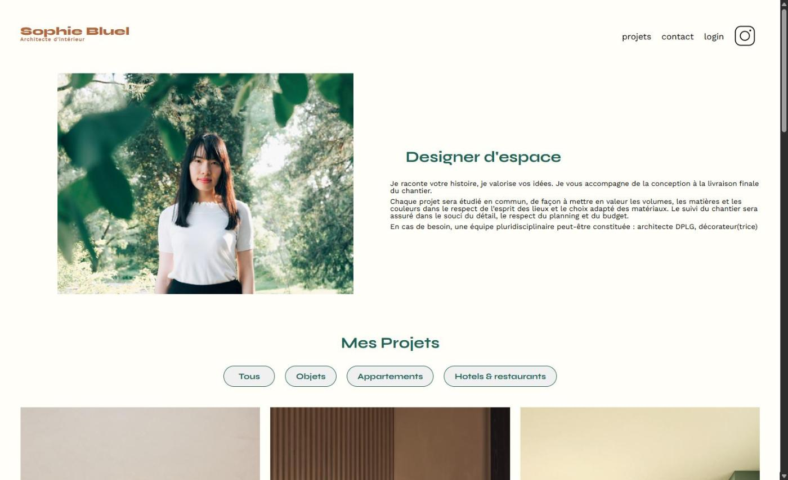
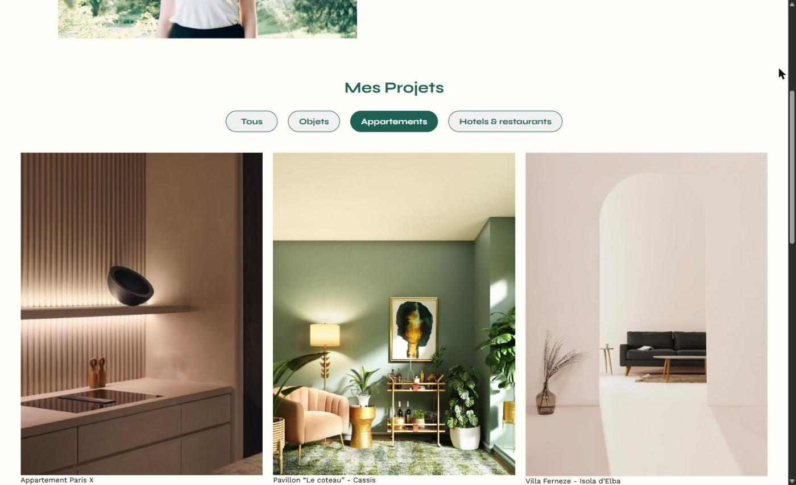
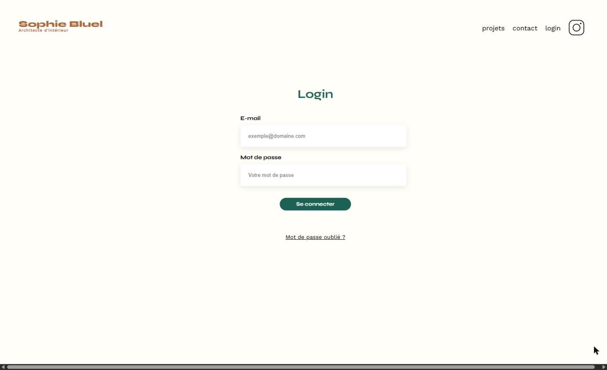
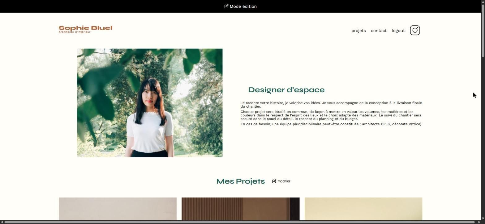
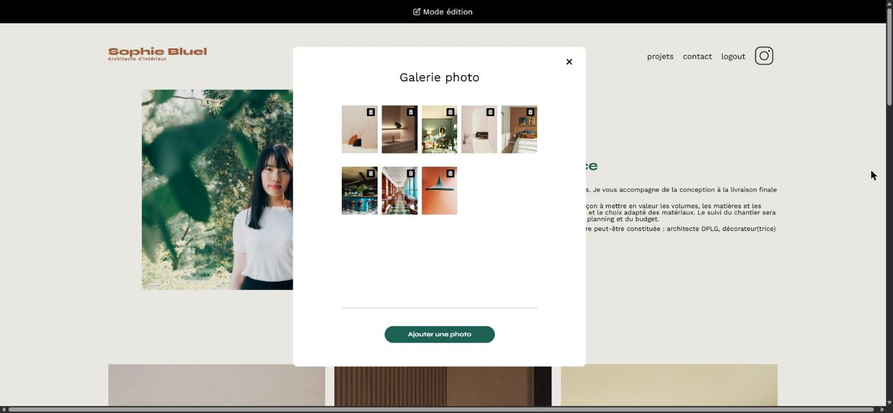
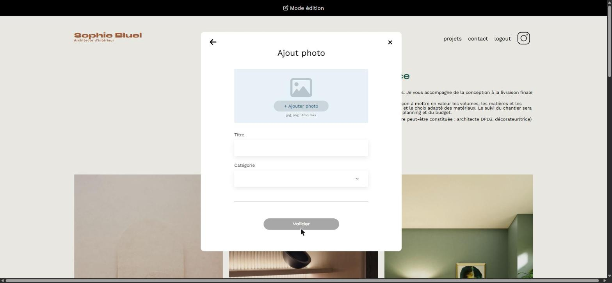

# 🏛️ Sophie Bluel – Portfolio d'architecte d'intérieur

🇫🇷 Français · 🇬🇧 [English](#-english)

## Contexte

Projet réalisé dans le cadre de la formation **Développeur Web d'OpenClassrooms**.
Sophie Bluel, architecte d'intérieur, souhaitait un site portfolio dynamique, avec un espace d'administration pour gérer elle-même ses projets. Ma mission : développer le **front-end en JavaScript** et le connecter à l'**API REST** fournie (Node.js / Express).

## Aperçu

| Page d'accueil | Galerie filtrée par catégorie |
|:---:|:---:|
|  |  |
| **Connexion** | **Mode édition** |
|  |  |
| **Suppression de projets** | **Ajout d'un projet** |
|  |  |

## Fonctionnalités

**Côté visiteur**
- Galerie de projets générée dynamiquement à partir de l'API (`fetch`, création des éléments du DOM)
- Filtres par catégorie créés à partir de l'API, avec un bouton « Tous » par défaut, sans nouvel appel au serveur

**Connexion**
- Page de connexion intégrée d'après la maquette Figma
- Envoi des identifiants en `POST`, stockage du token dans le `localStorage`, redirection en cas de succès, message d'erreur dans la page en cas d'échec

**Mode édition (utilisateur connecté)**
- Bandeau « mode édition », lien « logout » fonctionnel, filtres masqués et bouton « modifier »
- Une seule fenêtre modale accessible (`aria-hidden`, `aria-modal`, gestion du focus), fermeture par la croix ou par un clic à l'extérieur
- **Suppression** d'un projet (`DELETE` avec le token) : il disparaît de la modale et de la galerie, sans rechargement
- **Ajout** d'un projet : aperçu de l'image, catégories chargées depuis l'API, vérification du formulaire (titre, catégorie, image PNG ou JPEG de 4 Mo maximum), envoi en `FormData` et mise à jour des deux galeries sans rechargement

## Ce que ce projet m'a appris

- Consommer une API REST : méthodes `GET`, `POST`, `DELETE`, en-têtes, codes de réponse et documentation Swagger
- Gérer l'asynchrone avec les promesses, et vérifier `response.ok` avant de modifier la page
- Sécuriser les actions avec un token d'authentification
- Construire une interface accessible et fidèle à une maquette Figma

## Technologies

HTML5 · CSS3 · JavaScript (vanilla) · API REST · Node.js / Express (back-end fourni) · Swagger · Figma

## Lancer le projet en local

```bash
git clone https://github.com/Moldu77/Portfolio-architecte-sophie-bluel.git
```

1. **Back-end** : dans le dossier `Backend`, lancer `npm install` puis `npm start`, et laisser le terminal ouvert. L'API tourne sur `http://localhost:5678`. Le compte de test et le lien vers la documentation Swagger sont dans [`Backend/README.md`](Backend/README.md).
2. **Front-end** : ouvrir le dossier `FrontEnd` avec l'extension Live Server de VS Code.

---

## 🇬🇧 English

**Context:** project completed as part of the **OpenClassrooms Web Developer** program. The goal was to build the **JavaScript front-end** of an interior architect's portfolio and connect it to a provided **REST API** (Node.js / Express).

**Features:**

- **Visitors:** project gallery generated from the API, category filters with a default "All" button
- **Login:** credentials sent with `POST`, token stored in `localStorage`, redirect on success, in-page error message on failure
- **Edit mode (logged-in user):** edit banner, working logout, single accessible modal, **delete** projects (`DELETE` with token) and **add** projects (image preview, form validation, `FormData` upload), with both galleries updated without reloading the page

**Tech stack:** HTML5 · CSS3 · Vanilla JavaScript · REST API · Node.js / Express (provided back-end) · Swagger · Figma

**Run locally:** start the back-end in `Backend` (`npm install`, then `npm start`), then open `FrontEnd` with VS Code Live Server.

---

👤 **Auteur / Author :** Maxym Duculty – [LinkedIn](https://www.linkedin.com/in/maxym-duculty) · [GitHub](https://github.com/Moldu77)
